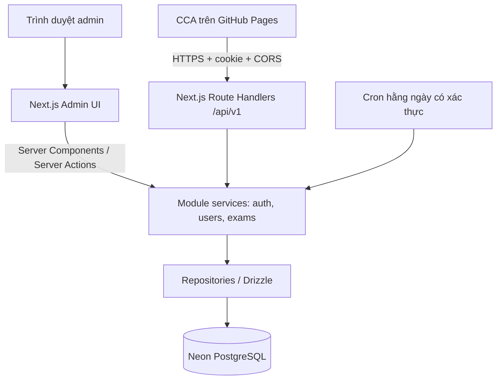

# Kiến trúc, công nghệ và cấu trúc CCA API/Admin

Cập nhật: 2026-11-12. Đã triển khai scaffold Next.js và schema/migration 8 bảng; chưa triển khai nghiệp vụ hoặc dịch vụ thật. Xem [hướng dẫn local](development.md). Quy mô mục tiêu khoảng 10 user, sử dụng không thường xuyên. Người dùng đã chốt 8 bảng; [database-design.md](database-design.md) là nguồn schema, [auth-and-api-design.md](auth-and-api-design.md) là nguồn quy tắc nghiệp vụ.

## Phạm vi và lựa chọn kiến trúc

Một ứng dụng Next.js theo modular monolith: module có trách nhiệm rõ ràng nhưng dùng chung deployment và database. Vercel phục vụ admin và API; frontend thi `/cca` vẫn ở GitHub Pages của `../next-pro`. Không dùng static export cho ứng dụng admin/API.

Bản đầu gồm đăng nhập, kích hoạt mật khẩu, quản lý user, import ngân hàng, API thi và kết quả tổng hợp. Chưa xây UI quản lý câu hỏi, báo cáo, dashboard thống kê hoặc màn hình audit. Chưa cần backend riêng, microservices, Redis, queue hay WebSocket.



Admin Server Components đọc dữ liệu qua service trực tiếp, không gọi HTTP tới API của chính ứng dụng. Client Components gọi REST khi cần tương tác; Server Actions chỉ là adapter cho form admin, dùng chung service. Frontend CCA bên ngoài gọi REST. Mọi điểm vào máy chủ kiểm tra auth, quyền và dữ liệu; service không tin user ID/role gửi từ client.

## Công nghệ dự kiến

| Thành phần      | Lựa chọn                                         | Quy tắc sử dụng                                                            |
| --------------- | ------------------------------------------------ | -------------------------------------------------------------------------- |
| Framework       | Next.js App Router, React, TypeScript strict     | Chọn phiên bản stable tương thích khi scaffold, khóa bằng lockfile         |
| Runtime/hosting | Node.js LTS được Vercel hỗ trợ, Vercel Functions | Request ngắn; không giữ Function suốt bài thi                              |
| UI              | Tailwind CSS, shadcn/ui                          | Responsive, sáng/tối, dùng token nhất quán                                 |
| Form/validation | React Hook Form, Zod                             | Validate lại tại server; contract đầu vào/đầu ra rõ ràng                   |
| Database        | Neon PostgreSQL Free                             | Không dùng filesystem của Function để lưu trạng thái                       |
| ORM/migration   | Drizzle ORM, Drizzle Kit, SQL migration          | Review SQL; migration chạy có kiểm soát, không tự chạy mỗi request         |
| Kết nối         | Neon serverless driver qua WebSocket             | Hỗ trợ interactive transaction; quản lý vòng đời kết nối phù hợp Functions |
| Auth            | Opaque token + bảng auth_sessions                | Token ngẫu nhiên trong cookie, chỉ lưu hash tại DB                         |
| Crypto          | node:crypto scrypt có salt, randomBytes          | Hash password ở server; so sánh verifier an toàn                           |
| API             | REST JSON /api/v1                                | Route Handler mỏng; DTO không có đáp án hoặc password_hash                 |
| Background      | Vercel Cron hằng ngày                            | Dọn phiên/rate limit, finalize bài hết hạn theo batch                      |
| Kiểm thử        | Vitest, PostgreSQL test, Playwright              | Test thuật toán, giao dịch thực và hành trình trình duyệt                  |
| Chất lượng/CI   | ESLint, Prettier, typecheck, GitHub Actions      | Kiểm tra trước deploy; Vercel build từ Git                                 |
| Logging         | JSON có request ID qua console                   | Không log mật khẩu, token, đáp án, snapshot hoặc lựa chọn chi tiết         |

Đánh dấu code DB, crypto và nghiệp vụ có dữ liệu nhạy cảm bằng `server-only`. Contract và DTO được phép dùng ở client phải tách khỏi schema database. Không cần thư viện quản lý state toàn cục cho bản đầu.

## Cấu trúc thư mục mục tiêu

```text
src/
  app/
    (auth)/
      login/page.tsx
      setup-password/page.tsx
    (admin)/admin/
      layout.tsx
      users/page.tsx
      users/[userId]/page.tsx
    api/
      v1/
        auth/                  # login, session, setup-password, logout
        admin/users/           # danh sách, cấp user, khóa/mở, reset mật khẩu
        exams/                 # chủ đề, đề, bắt đầu/lưu/nộp/bỏ, summary
      internal/cron/route.ts
    layout.tsx
    error.tsx
    globals.css
  modules/
    auth/
    users/
    question-bank/
    exams/
      domain/                  # form-generator, grading, policies; không phụ thuộc Next/DB
      server/                  # service, repository; server-only
      contracts/               # Zod schemas và DTO an toàn cho client
  components/
    ui/
    layout/
  server/
    db/client.ts
    db/schema/                 # định nghĩa 8 bảng, khóa ngoại, index
    security/                  # password, session token, CSRF, rate limit
    http/                      # CORS, error mapping, request ID
    observability/             # structured logging
  shared/
    config/                    # cấu hình chủ đề; tách env server và public
    utils/
drizzle/                       # SQL migration có version
scripts/                       # import-questions, create-admin
tests/
  integration/
  e2e/
data/                          # nguồn import riêng tư; không import vào UI
docs/
public/                        # chỉ asset công khai
.env.example
drizzle.config.ts
next.config.ts
vercel.json
```

Mỗi module chỉ tạo các lớp cần thiết; áp dụng mẫu `domain/server/contracts` khi có logic tương ứng. Component/form riêng cho user đặt trong `modules/users/components/`, không đưa tất cả vào components dùng chung. Unit test đặt cạnh logic. Repository chịu trách nhiệm truy vấn, service điều phối nghiệp vụ và transaction; không tạo generic repository hoặc framework DI ở bản đầu.

## Quy tắc triển khai nghiệp vụ

1. Route Handler/Server Action kiểm tra request, phiên, quyền và CSRF, sau đó gọi service. Kiểm tra quyền sở hữu lượt thi trong mọi thao tác thi.
2. Service xử lý nghiệp vụ; transaction bao trùm thay đổi cần nguyên tử. Repository nhận transaction context khi cần, không tự commit giữa chừng.
3. Trả DTO theo allowlist. API phiên, đề và kết quả cá nhân dùng `Cache-Control: no-store`; không cache chung dữ liệu giữa user.
4. Lỗi trả mã ổn định cùng thông báo an toàn và request ID; không lộ SQL/stack trace. Phân biệt chưa đăng nhập, không có quyền, xung đột trạng thái và giới hạn request.
5. Khi mất mạng, UI chỉ coi đáp án đã lưu khi server xác nhận. Không dùng browser storage để cấp lượt hoặc xác định deadline.

## Vercel Hobby và Neon Free

Với tải dự kiến, bắt đầu bằng hai gói miễn phí. Hobby dành cho sử dụng cá nhân, phi thương mại; không suy ra tính phù hợp điều kiện sử dụng chỉ từ số user. Hạn mức được chia sẻ theo phạm vi tài khoản/team tương ứng, cần theo dõi Usage sau deploy.

Active CPU là thời gian thực sự xử lý code, không phải thời gian người dùng mở trang hay chờ database. Bài 120 phút lưu `expires_at`; đồng hồ UI chạy trên trình duyệt. Không polling mỗi giây, không heartbeat giữ database thức. Lưu đáp án theo thay đổi và gộp các thay đổi nhanh khi phù hợp.

Cron Hobby hiện chỉ chạy mỗi ngày và không bảo đảm chính xác đến phút. Deadline được bảo vệ tại mọi request bằng giờ máy chủ. Khi hết hạn, request tiếp theo hoặc Cron finalize bài từ dữ liệu đã được server xác nhận trước deadline. Nếu người dùng đóng trình duyệt, summary và việc xóa payload có thể trễ tới đợt xử lý sau. Không hứa xóa dữ liệu đúng phút hết giờ khi dùng thiết kế này.

Cron có secret, xử lý theo batch có giới hạn và idempotent; có thể tiếp tục batch còn lại bằng request nghiệp vụ sau. Neon có thể tạm dừng compute khi không dùng, nên lần truy cập đầu có thể chậm hơn. Chọn vùng Vercel/Neon gần nhau; không triển khai keep-alive chỉ để tránh cold start.

Không ghi cứng quota vào thiết kế vì nhà cung cấp có thể thay đổi. Nguồn đối chiếu ngày 2026-11-12:

- [Vercel Hobby](https://vercel.com/docs/plans/hobby)
- [Fluid Compute và cách tính CPU/memory](https://vercel.com/docs/functions/usage-and-pricing)
- [Giới hạn Cron](https://vercel.com/docs/schedules/cron-jobs/usage-and-pricing)
- [Neon pricing](https://neon.com/pricing)
- [Drizzle và Neon driver](https://orm.drizzle.team/docs/connect-neon)
- [Next.js BFF](https://nextjs.org/docs/app/guides/backend-for-frontend)
- [Next.js data security](https://nextjs.org/docs/app/guides/data-security)

## Môi trường và bảo mật

- `DATABASE_URL` và `CRON_SECRET` chỉ tồn tại ở server; env được validate lúc khởi động/build phù hợp. Không đưa secret vào `NEXT_PUBLIC_*`.
- Frontend Pages chỉ nhận `NEXT_PUBLIC_CCA_API_URL`. CORS allowlist origin chính xác, `credentials: include`; hỗ trợ preflight cho method/header cần thiết.
- Cookie production có HttpOnly, Secure, Path=/ và SameSite phù hợp. Ưu tiên host-only cookie trên API/admin, hai frontend dùng HTTPS cùng domain gốc. Kiểm tra Origin/CSRF cho mutation, kể cả login/logout. Domain production thực tế còn cần chốt.
- Preview/local dùng database test riêng, không trỏ nhầm production. Không copy dữ liệu có đáp án sang public assets hay bundle client.
- Mật khẩu tạm chỉ trả lúc cấp/reset; không ghi vào audit/log. Admin đầu tiên tạo qua script riêng, không có đăng ký admin công khai.

## Thứ tự chuẩn bị triển khai

1. Chốt các câu hỏi nghiệp vụ còn mở trong tài liệu auth: quyền reset lượt, đổi role/username, phiên gần hết hạn, domain và dữ liệu cũ cần giữ.
2. Scaffold stack, env validation, schema 8 bảng và migration; cấu hình test DB riêng.
3. Xây import có kiểm tra checksum/số lượng, cấp admin và auth/password setup.
4. Chuyển engine thi và storage sang PostgreSQL; bảo vệ đồng thời, deadline và finalize.
5. Xây admin user cùng audit; nối CCA frontend với API cookie.
6. Chạy unit test về phủ đề/chấm điểm, integration về transaction/quyền/deadline và E2E về kích hoạt, thi, thoát, khóa tài khoản.
7. Kiểm tra build không lộ bank/đáp án; cấu hình domain, Cron, secrets, migration và smoke test trước chuyển API URL thật.

Đây là thứ tự định hướng, chưa phải cam kết các chính sách còn mở đã được duyệt. Không thực hiện migration dữ liệu cũ hoặc deploy production trong lần cập nhật docs này.
