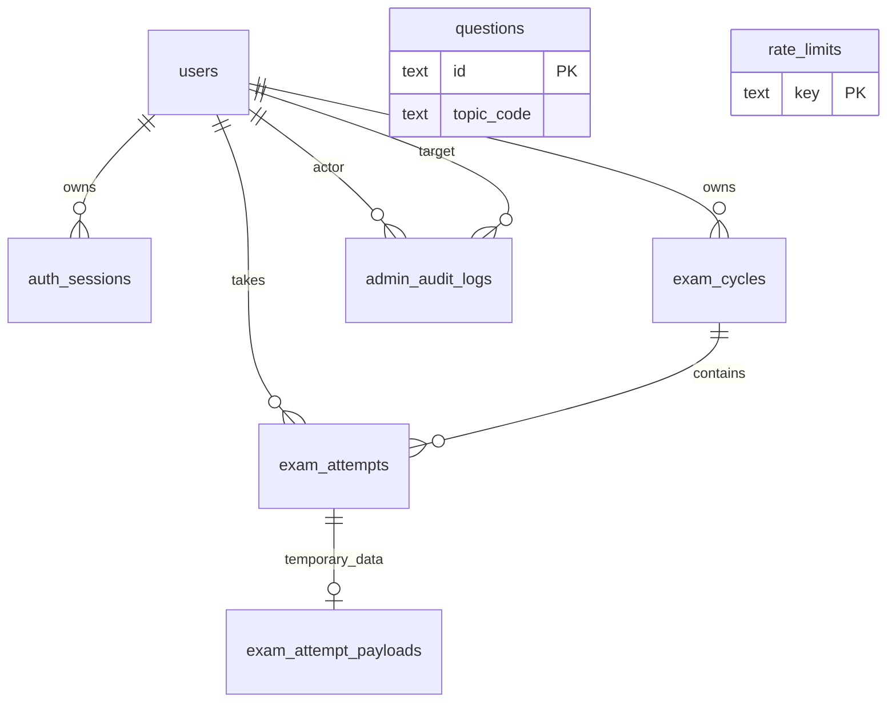

# Schema 8 bảng và relationship

Cập nhật: 2026-11-12. Đã chốt số lượng và trách nhiệm 8 bảng cho bản đầu. Các cột/ràng buộc đã được thể hiện trong schema Drizzle và migration SQL đầu tiên tại drizzle/0000_initial_schema.sql. Migration đã có test PostgreSQL embedded; chưa áp dụng lên Neon thật. Xem [kiến trúc](architecture.md) và [nghiệp vụ auth/thi](auth-and-api-design.md).

## Quy ước chung

- Tên snake_case; UUID cho định danh, trừ ID câu hỏi nguồn và key rate limit. Tất cả thời điểm dùng TIMESTAMPTZ.
- Cột mặc định NOT NULL trừ khi ghi nullable. created_at/updated_at mặc định now(); updated_at được cập nhật bởi Drizzle $onUpdate khi dùng ORM. SQL viết tay phải cập nhật updated_at rõ ràng; migration không cài trigger.
- CHECK cho tập giá trị hữu hạn, FK và unique thực thi ở PostgreSQL, không chỉ validate bằng TypeScript.
- Ba topic cố định: cca-f, ccao-f, ccar-p. Không cần bảng topics, roles, permissions hoặc results.
- Không xóa cứng user trong bản đầu; dùng disabled và thu hồi phiên. FK dùng NO ACTION để tránh xóa nhầm lịch sử; ngoại lệ payload có ON DELETE CASCADE theo attempt.

## 1. users

| Cột                    | Kiểu / ràng buộc                            | Ý nghĩa                                                         |
| ---------------------- | ------------------------------------------- | --------------------------------------------------------------- |
| id                     | UUID PK                                     | Định danh                                                       |
| username               | VARCHAR(64) UNIQUE                          | Chuẩn hóa lowercase/trim; CHECK giá trị chuẩn hóa và không rỗng |
| password_hash          | TEXT                                        | Verifier scrypt gồm salt và tham số; không lưu mật khẩu gốc     |
| role                   | TEXT CHECK admin/student                    | Vai trò                                                         |
| status                 | TEXT CHECK pending_password/active/disabled | Trạng thái                                                      |
| first_login_at         | TIMESTAMPTZ nullable                        | Thời điểm kích hoạt thành công lần đầu                          |
| last_login_at          | TIMESTAMPTZ nullable                        | Đăng nhập thành công gần nhất                                   |
| created_at, updated_at | TIMESTAMPTZ                                 | Thời điểm tạo/cập nhật                                          |

## 2. auth_sessions

| Cột                    | Kiểu / ràng buộc                        | Ý nghĩa                                      |
| ---------------------- | --------------------------------------- | -------------------------------------------- |
| id                     | UUID PK                                 | Định danh phiên                              |
| user_id                | UUID FK users.id                        | Chủ phiên                                    |
| token_hash             | TEXT UNIQUE                             | Hash token ngẫu nhiên trong cookie           |
| kind                   | TEXT CHECK password_setup/authenticated | Loại phiên                                   |
| expires_at             | TIMESTAMPTZ                             | Hạn tuyệt đối; phiên authenticated là 24 giờ |
| revoked_at             | TIMESTAMPTZ nullable                    | Thời điểm thu hồi                            |
| created_at, updated_at | TIMESTAMPTZ                             | Thời điểm tạo/cập nhật                       |

Index user_id phục vụ thu hồi phiên; index expires_at phục vụ dọn dẹp. CHECK expires_at > created_at. Password setup đã triển khai hạn 10 phút; phiên authenticated giữ hạn tuyệt đối 24 giờ. API luôn kiểm tra cả user.status và kind; phiên setup không được thi hoặc gọi admin API.

## 3. questions

| Cột                    | Kiểu / ràng buộc                                       | Ý nghĩa                                          |
| ---------------------- | ------------------------------------------------------ | ------------------------------------------------ |
| id                     | TEXT PK                                                | Giữ ID như cca-f-001                             |
| topic_code             | TEXT CHECK ba topic                                    | Chủ đề                                           |
| question_type          | TEXT CHECK single_choice/multiple_response/unsupported | Loại câu; import chuẩn hóa loại không hỗ trợ     |
| prompt                 | TEXT nullable                                          | Nội dung; có thể thiếu ở câu needs_review        |
| choices                | JSONB                                                  | Mảng {id, text}; [] nếu thiếu dữ liệu            |
| correct_choice_ids     | TEXT[]                                                 | Đáp án; mảng rỗng được phép cho câu needs_review |
| status                 | TEXT CHECK ready/needs_review/disabled                 | Điều kiện được sinh đề                           |
| source_number          | INTEGER CHECK > 0                                      | Số câu nguồn                                     |
| created_at, updated_at | TIMESTAMPTZ                                            | Thời điểm nhập/cập nhật                          |

Unique (topic_code, source_number); index (topic_code, status). Với ready, importer phải xác nhận prompt không rỗng, choices đủ và ID lựa chọn duy nhất, đáp án thuộc choices; single_choice có đúng một đáp án, multiple_response có nhiều đáp án. Có CHECK cơ bản cho cấu trúc JSON/mảng và điều kiện ready trong migration; kiểm tra liên kết nội dung chi tiết bằng importer/service.

Import đủ 459 dòng, chỉ 456 ready: CCA-F 162, CCAO-F 145, CCAR-P 149. CCAR-P 037, 136, 138 giữ needs_review. Không yêu cầu prompt/đáp án hợp lệ cho cả 459 dòng vì sẽ loại mất các dòng cần rà soát. Không copy trường raw chứa đáp án vào DTO.

## 4. exam_cycles

| Cột                    | Kiểu / ràng buộc     | Ý nghĩa                                                     |
| ---------------------- | -------------------- | ----------------------------------------------------------- |
| id                     | UUID PK              | Chu kỳ                                                      |
| user_id                | UUID FK users.id     | Chủ chu kỳ                                                  |
| topic_code             | TEXT CHECK ba topic  | Chủ đề                                                      |
| seed                   | TEXT                 | Seed sinh 10 đề có thể tái tạo                              |
| bank_version           | TEXT                 | Checksum ngân hàng đã chuẩn hóa, không phải FK              |
| generator_version      | TEXT                 | Phiên bản thuật toán sinh đề để giữ kết quả tái tạo ổn định |
| closed_at              | TIMESTAMPTZ nullable | NULL là chu kỳ hiện hành                                    |
| created_at, updated_at | TIMESTAMPTZ          | Thời điểm tạo/cập nhật                                      |

Partial unique (user_id, topic_code) WHERE closed_at IS NULL: tối đa một chu kỳ hiện hành cho một user/chủ đề. Unique (id, user_id) làm đích FK ghép ở attempts. Chu kỳ dùng hết 10 lượt không tự cấp thêm lượt; không tự đóng/tạo mới để vượt hạn mức. Quyền và thao tác reset còn cần chốt.

Không có question_bank_versions ở bản đầu. Import ban đầu được phép chạy lại idempotent khi checksum không đổi. Không thay nội dung ngân hàng hoặc thuật toán dưới cùng version; không import đè khi còn chu kỳ hiện hành. Thay phiên bản cần quy trình đóng chu kỳ được duyệt, hoặc mở rộng schema versioning sau này. Checksum chỉ nhận diện phiên bản, không tự lưu dữ liệu cũ.

## 5. exam_attempts

| Cột                        | Kiểu / ràng buộc                                     | Ý nghĩa                                                      |
| -------------------------- | ---------------------------------------------------- | ------------------------------------------------------------ |
| id                         | UUID PK                                              | Lượt thi                                                     |
| cycle_id                   | UUID                                                 | Thành phần FK ghép                                           |
| user_id                    | UUID FK users.id                                     | Chủ lượt thi; phục vụ unique bài đang chạy                   |
| form_number                | SMALLINT CHECK 1–10                                  | Số đề                                                        |
| status                     | TEXT CHECK in_progress/submitted/abandoned/timed_out | Trạng thái                                                   |
| started_at                 | TIMESTAMPTZ                                          | Bắt đầu và tiêu thụ lượt                                     |
| expires_at                 | TIMESTAMPTZ                                          | Deadline = started_at + 120 phút                             |
| ended_at                   | TIMESTAMPTZ nullable                                 | Mốc kết thúc hiệu lực; timeout dùng expires_at               |
| finalized_at               | TIMESTAMPTZ nullable                                 | Thời điểm thực sự chấm/xóa payload, có thể muộn hơn deadline |
| total                      | INTEGER CHECK > 0                                    | 60 hoặc 63 theo chủ đề của chu kỳ                            |
| correct, wrong, unanswered | INTEGER nullable                                     | Chưa có khi đang thi; số nguyên không âm khi kết thúc        |
| simulated_score            | INTEGER nullable                                     | round(100 + 900 × correct / total), chỉ tính sau chấm        |
| created_at, updated_at     | TIMESTAMPTZ                                          | Thời điểm tạo/cập nhật                                       |

- FK (cycle_id, user_id) → exam_cycles(id, user_id): chống gắn lượt vào chu kỳ của người khác.
- Unique (cycle_id, form_number): mỗi đề chỉ dùng một lần trong chu kỳ.
- Partial unique (user_id) WHERE status = 'in_progress': một bài đang chạy/user, kể cả khác chủ đề.
- Index expires_at WHERE status = 'in_progress' phục vụ cleanup; index (user_id, started_at) phục vụ lịch sử.
- CHECK expires_at = started_at + interval '120 minutes'. Bài đang thi có ended_at/finalized_at/kết quả NULL; bài kết thúc có đủ các trường này, correct + wrong + unanswered = total, điểm trong 100–1000 và khớp công thức mô phỏng. ended_at nằm giữa started_at và expires_at, finalized_at không trước ended_at; timed_out có ended_at = expires_at. Service đối chiếu total với topic qua cycle.
- Partial unique không tự bỏ qua bài đã quá hạn: trước khi bắt đầu bài khác, service khóa user và finalize bài cũ hết hạn trong cùng transaction.

## 6. exam_attempt_payloads

| Cột               | Kiểu / ràng buộc                               | Ý nghĩa                                                          |
| ----------------- | ---------------------------------------------- | ---------------------------------------------------------------- |
| attempt_id        | UUID PK/FK exam_attempts.id, ON DELETE CASCADE | Tối đa một payload/lượt                                          |
| question_snapshot | JSONB                                          | Câu hỏi được giao, thứ tự lựa chọn và đáp án chấm riêng ở server |
| answers           | JSONB                                          | Map question_id → danh sách choice_id đã được server xác nhận    |
| updated_at        | TIMESTAMPTZ                                    | Lần lưu gần nhất                                                 |

Snapshot cố định lúc bắt đầu, không thay đổi khi lưu answers. API chỉ serialize phần đề/lựa chọn được phép hiển thị, tuyệt đối không trả đáp án chấm. Service kiểm tra câu hỏi thuộc snapshot và lựa chọn thuộc câu đó. Payload cùng attempt được tạo trong một transaction; finalize cập nhật summary và DELETE payload trong một transaction. DB không tự bảo đảm quan hệ theo status nên service và integration test phải kiểm tra invariant này.

Sau finalize không có lịch sử từng câu. Xóa là ở mức ứng dụng; không cam kết xóa ngay khỏi backup hoặc WAL của nhà cung cấp.

## 7. rate_limits

| Cột               | Kiểu / ràng buộc   | Ý nghĩa                                                         |
| ----------------- | ------------------ | --------------------------------------------------------------- |
| key               | TEXT PK            | Namespace + định danh bucket; ưu tiên hash định danh cần bảo vệ |
| window_started_at | TIMESTAMPTZ        | Bắt đầu cửa sổ đếm                                              |
| count             | INTEGER CHECK >= 0 | Số lần thử                                                      |
| expires_at        | TIMESTAMPTZ        | Hạn bucket để dọn dẹp                                           |

Không FK tới users: cần kiểm soát cả IP và username chưa tồn tại. Cập nhật bộ đếm nguyên tử bằng UPSERT/khóa phù hợp, không read rồi write riêng. Index expires_at để cleanup; CHECK expires_at > window_started_at. Auth đã dùng cửa sổ login 15 phút (10/username, 50/IP) và setup 10 phút (5/user); không log raw password/token trong key.

## 8. admin_audit_logs

| Cột            | Kiểu / ràng buộc                             | Ý nghĩa                                                                             |
| -------------- | -------------------------------------------- | ----------------------------------------------------------------------------------- |
| id             | UUID PK                                      | Định danh sự kiện                                                                   |
| actor_user_id  | UUID FK users.id                             | Admin thực hiện                                                                     |
| target_user_id | UUID FK users.id                             | User bị tác động                                                                    |
| action         | TEXT CHECK theo tập thao tác được triển khai | create_user, disable_user, enable_user, reset_password; mở rộng khi duyệt quyền mới |
| metadata       | JSONB                                        | Chi tiết theo allowlist, ví dụ trạng thái trước/sau và request ID                   |
| created_at     | TIMESTAMPTZ                                  | Thời điểm thao tác                                                                  |

Index (actor_user_id, created_at) và (target_user_id, created_at). Chỉ append qua service; bản đầu không có API sửa/xóa audit. Không lưu password, password_hash, token, đáp án hoặc toàn bộ request body. Ghi log trong cùng transaction với thao tác thành công; lỗi/đăng nhập thất bại dùng operational logging, không giả làm thao tác admin thành công. Script bootstrap tạo admin đầu tiên là bước kỹ thuật riêng, không tạo audit có actor giả.

## Relationship

| Quan hệ                         | Cardinality / quy tắc                                       |
| ------------------------------- | ----------------------------------------------------------- |
| User → session                  | 1–N                                                         |
| User → cycle                    | 1–N; tối đa 3 hiện hành, mỗi topic một chu kỳ               |
| User → attempt                  | 1–N; tối đa một in_progress                                 |
| Cycle → attempt                 | 1–N; tối đa 10 nhờ form_number và unique                    |
| Attempt → payload               | 1–0..1; có khi đang thi, bị xóa sau finalize                |
| User → audit với vai trò actor  | 1–N; service yêu cầu actor là admin                         |
| User → audit với vai trò target | 1–N                                                         |
| Question → snapshot             | Tham chiếu logic qua dữ liệu sao chép; không FK trong JSONB |
| Rate limit → user               | Không có FK                                                 |

questions độc lập về FK nhưng được exam service chọn theo topic/version khi sinh đề. Không cần bảng nối attempt_questions vì không lưu review từng câu sau bài thi.

## Transaction và thứ tự khóa

Các luồng ghi của cùng một user khóa dòng users trước, sau đó cycle/attempt liên quan để giảm deadlock. Không giữ khóa trong lúc hash mật khẩu; thực hiện hash trước rồi kiểm tra lại trạng thái/version verifier dưới khóa trước khi ghi.

| Luồng                    | Các thay đổi cần nguyên tử                                                                                    |
| ------------------------ | ------------------------------------------------------------------------------------------------------------- |
| Kích hoạt mật khẩu       | Kiểm tra lại phiên setup/user, đổi hash/status, thu hồi phiên setup và phiên cũ, tạo phiên authenticated mới  |
| Bắt đầu bài              | Kiểm tra auth lại, khóa user/cycle, chốt bài cũ hết hạn, kiểm tra lượt/form, tạo attempt + payload            |
| Lưu đáp án               | Khóa user/attempt, kiểm tra quyền và deadline trước khi ghi payload; hết hạn thì finalize thay vì nhận đáp án |
| Nộp/bỏ/hết giờ           | Khóa user/attempt, chấm một lần, ghi summary/status, xóa payload; request lặp trả summary đã có               |
| Khóa user/reset mật khẩu | Cập nhật user, thu hồi session, ghi audit; trạng thái bài đang thi theo chính sách cần chốt                   |
| Cleanup                  | Xử lý bài hết hạn theo cùng lock order và service finalize; dọn session/rate limit hết hạn theo batch         |

Mọi lần finalize phải đối chiếu deadline: nếu đã hết giờ thì không nhận thêm answers dù request là submit. Kiểm thử đồng thời phải chứng minh không tạo hai bài đang chạy, không dùng một form hai lần và không chấm hai lần. Phương thức kiểm tra auth không thay thế kiểm tra trạng thái user bên trong transaction ghi.

## Các quyết định nghiệp vụ còn mở

- Ai có quyền reset chu kỳ/lượt, reset có giữ summary cũ hay xóa, xử lý bài đang chạy ra sao.
- Có cho sửa username/role, ai được làm và bảo vệ admin cuối cùng như thế nào.
- Admin reset xóa hash và chuyển về pending_password; setup bằng username trong 10 phút, mật khẩu mới 12–128 ký tự.
- Yêu cầu đăng nhập lại khi phiên còn dưới 120 phút; xử lý bài khi khóa tài khoản hoặc phiên hết hạn.
- Có dữ liệu production SQLite phải chuyển không; domain và origin thực tế.

Các mục này không thay đổi việc đã chốt 8 bảng, nhưng phải được quyết định trước khi triển khai luồng liên quan. Không mặc định khôi phục quyền tự reset bằng room code từ tài liệu archive.
